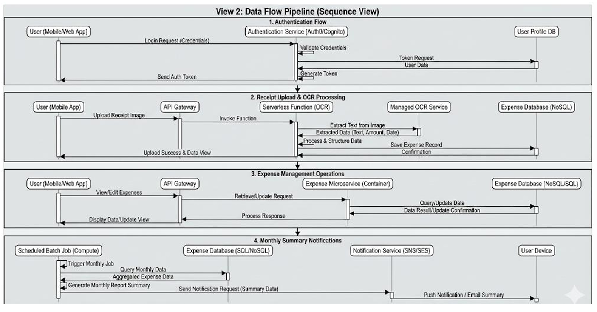
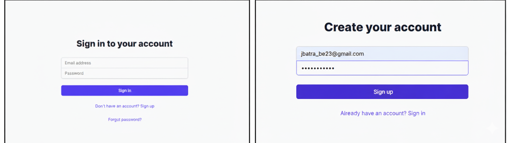
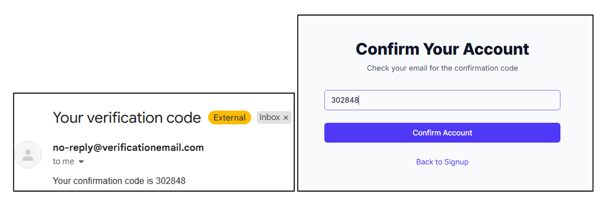
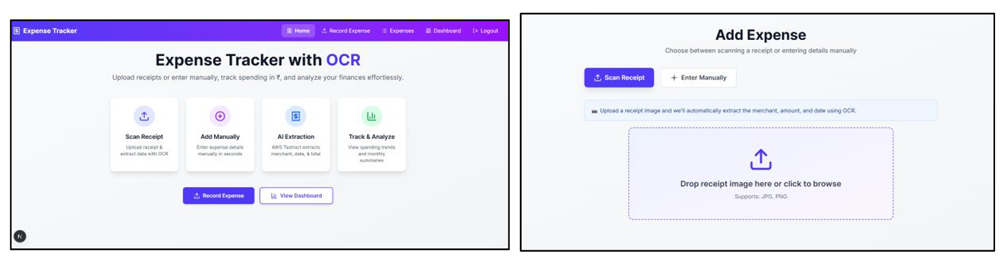
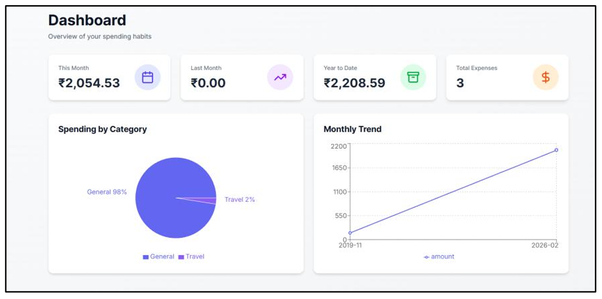

# CloudExpense | Cloud-Based Expense Tracker with Receipt OCR

CloudExpense is an academic cloud-computing project that helps users record expenses from receipt images, review extracted details, and analyze their spending.

> **Project status:** Academic MVP. This repository contains the application source and supporting AWS configuration. Do not describe it as production-ready. Some deployment/IaC files are legacy drafts and must be reviewed before use.

## Table of Contents

1. [Overview](#1-overview)
2. [Problem Statement](#2-problem-statement)
3. [Architecture](#3-architecture)
4. [Tech Stack](#4-tech-stack)
5. [Core Workflows](#5-core-workflows)
6. [Infrastructure as Code](#6-infrastructure-as-code)
7. [Containerization and Deployment](#7-containerization-and-deployment)
8. [Security](#8-security)
9. [Scalability and Limitations](#9-scalability-and-limitations)
10. [Testing](#10-testing)
11. [Project Structure](#11-project-structure)
12. [Setup and Deployment](#12-setup-and-deployment)
13. [Future Enhancements](#13-future-enhancements)
14. [Author](#14-author)

## 1. Overview

CloudExpense is a cloud-integrated expense tracker built with a Next.js frontend and a Node.js/Express backend. Users can create an account, upload a receipt image, review OCR-extracted details, save expenses, and view expense summaries and charts.

Implemented application capabilities include:

- Cognito-based signup, email confirmation, login, and password-reset flows
- Private S3 receipt storage using time-limited presigned URLs
- Receipt text extraction using **Tesseract.js** (not AWS Textract)
- Expense persistence and per-user retrieval through DynamoDB
- Expense dashboard with charts, summaries, and expense history
- CSV export endpoint for expense records
- Optional CloudWatch metrics and SES email integration
- An SNS monthly-summary trigger endpoint that can be invoked manually

## 2. Problem Statement

Manual expense tracking requires users to enter receipt information repeatedly. This can be time-consuming and may introduce data-entry errors.

CloudExpense reduces repetitive entry by extracting text from receipt images and parsing likely merchant, amount, date, and category values. Users can review the extracted values before saving them. OCR and parsing are heuristic and may require correction, especially for blurry, rotated, or unusual receipts.

## 3. Architecture

### 3.1 Component view

The application uses the following high-level components:

- **Client:** Next.js frontend
- **Application API:** Node.js and Express
- **Authentication:** Amazon Cognito User Pool
- **Receipt object storage:** Amazon S3
- **Expense database:** Amazon DynamoDB
- **OCR engine:** Tesseract.js running in the backend
- **Optional monitoring:** Amazon CloudWatch custom metrics
- **Optional email:** Amazon SES
- **Summary notifications:** Amazon SNS


### 3.2 Receipt data flow

1. A signed-in user selects a receipt image.
2. The backend creates a short-lived presigned S3 upload URL.
3. The browser uploads the image directly to the private S3 bucket.
4. The backend retrieves the uploaded object and runs Tesseract.js OCR.
5. The parser estimates receipt fields from the extracted text.
6. The frontend displays the result for review.
7. The user saves the confirmed expense to DynamoDB.
8. The dashboard requests the user's saved expenses and renders summaries/charts.



### 3.3 Infrastructure view

The repository includes a legacy CloudFormation template, now labelled `backend/infrastructure-template-DRAFT-DO-NOT-DEPLOY.yaml`. It contains outdated resource references, broad permissions, and deployment assumptions that need correction. It is **not a verified one-click deployment template** and should not be deployed as-is.


## 4. Tech Stack

| Layer | Technology | Purpose |
|---|---|---|
| Frontend | Next.js, React, TypeScript | Web UI and routes |
| Styling | Tailwind CSS | Responsive styling |
| Charts | Recharts | Expense visualizations |
| Backend | Node.js, Express | REST API |
| Authentication | Amazon Cognito | Signup, confirmation, login, password reset |
| Object storage | Amazon S3 | Receipt image storage |
| Database | Amazon DynamoDB | Expense records |
| OCR | Tesseract.js | Text extraction from receipt images |
| Notifications | Amazon SNS (optional) | Monthly summary publishing |
| Email | Amazon SES (optional) | Email notifications |
| Monitoring | Amazon CloudWatch (optional) | Custom count metrics |
| Containers | Docker, Docker Compose | Backend container workflow |

## 5. Core Workflows

### 5.1 Authentication

The frontend calls backend endpoints for signup, email confirmation, login, and password reset. Cognito manages the user pool and authentication. The frontend stores the returned tokens in browser local storage and sends the access token in the `Authorization: Bearer` header for protected API calls.





### 5.2 Receipt upload and OCR

The API creates a presigned S3 upload URL that expires after five minutes. The receipt remains in a private bucket; the application generates temporary download URLs when a receipt needs to be viewed. Tesseract.js extracts text, and the application parser estimates the merchant, total, date, and category.

**Important:** OCR is not guaranteed to be correct. Users should review the extracted values before saving.




### 5.3 Expense dashboard

The backend retrieves expense records using the authenticated user's identifier. The dashboard presents expense history, summary cards, category distribution, and monthly trends.



### 5.4 Expense export

The backend exposes `GET /expenses/export.csv` to export the authenticated user's expense records in CSV format.

### 5.5 Monthly summary notification

`POST /trigger-summary` runs the summary handler and publishes eligible previous-month summaries to the configured SNS topic. This endpoint is a manual trigger in the current application. A scheduled monthly run is **not verified/configured by the application source**, so the report must not claim that automatic scheduled emails are active.

SES-related email behavior is optional and requires a verified sender identity and appropriate AWS permissions.

## 6. Infrastructure as Code

A legacy CloudFormation template is retained for reference at:

```text
backend/infrastructure-template-DRAFT-DO-NOT-DEPLOY.yaml
```

It attempts to describe networking, EC2, IAM, Cognito, S3, DynamoDB, and SNS resources. However, it includes a fixed EC2 key-pair name, a hard-coded repository clone target, broad managed IAM policies, and port/configuration assumptions that do not match the current app consistently.

For safety, this template is documented as a draft rather than a verified IaC deployment. Before using it, update the repository URL, parameters, region-specific AMI, ports, IAM permissions, and startup configuration; then validate it with CloudFormation template validation and a controlled test stack.

## 7. Containerization and Deployment

The backend has a Dockerfile and a backend-only Docker Compose configuration. The frontend is a separate Next.js application and is not included as a service in the current Compose file.

| Component | Local development port |
|---|---:|
| Frontend | 3000 |
| Backend API | 3001 |

Docker availability and successful container deployment should be demonstrated with a local build/run test before claiming containerized deployment as verified.

## 8. Security

Current security-related design elements:

- Cognito-managed account authentication
- Bearer-token checks on protected API routes
- Private S3 receipt storage with presigned URLs
- Per-user expense retrieval using the Cognito subject identifier
- AWS credentials supplied through environment variables rather than committed secrets

Security limitations to address before any public deployment:

- Review CORS settings; wildcard origins should not be used casually in a public deployment.
- Remove any default/fallback JWT secret and require a strong configured secret if JWT signing remains part of the application.
- Use a least-privilege IAM policy. Avoid `s3:*`, `dynamodb:*`, `iam:*`, public-read bucket policies, and broad service-managed policies.
- Keep `.env` and credentials out of version control; rotate any credentials that may have been exposed.
- Restrict SSH access and expose only required application ports.
- Verify HTTPS configuration before describing the deployment as HTTPS-enforced.
- Keep the receipt bucket private; do not apply public-read policies to receipt objects.

## 9. Scalability and Limitations

### Current limitations

- Single backend process; no verified high-availability configuration
- OCR and field parsing are heuristic and can misread receipts
- The monthly summary handler uses a DynamoDB Scan, which is inefficient as the dataset grows
- Scheduled monthly execution is not configured/verified in the current application source
- The CloudFormation template is a draft and not safe for one-click deployment
- Automated test coverage is not established by the current package scripts

### Future enhancements

- Add automated unit/integration tests for authentication, OCR parsing, user isolation, and expense persistence
- Replace full-table scans with indexed/query-based aggregation when needed
- Configure a verified scheduled trigger for monthly summaries
- Improve receipt validation and user correction flow
- Complete and validate a least-privilege CloudFormation template
- Add HTTPS and a restricted CORS allowlist for public deployment

## 10. Testing

The backend package currently does not define a real automated test suite. The following manual test checklist can be used for a demonstration; mark each item as passed only after running it and recording evidence.

| Test | Expected result | Status |
|---|---|---|
| Signup and email confirmation | Cognito creates and confirms the user | Not verified in this document |
| Login | Valid credentials return tokens | Not verified in this document |
| Protected endpoint without token | Request is rejected | Not verified in this document |
| Receipt upload | Image is stored in private S3 | Not verified in this document |
| OCR preview | Text is extracted and fields are shown for review | Not verified in this document |
| Save expense | Expense is stored in DynamoDB | Not verified in this document |
| User isolation | One user cannot retrieve another user's expenses | Not verified in this document |
| CSV export | Current user's expenses download as CSV | Not verified in this document |
| Monthly summary trigger | Summary is published to SNS when configured | Not verified in this document |

## 11. Project Structure

```text
CloudExpense-main/
|-- backend/
|   |-- src/
|   |   |-- handlers/
|   |   |-- middleware/
|   |   |-- models/
|   |   `-- utils/
|   |-- server.js
|   |-- Dockerfile
|   |-- docker-compose.yml
|   |-- .env.example
|   `-- infrastructure-template-DRAFT-DO-NOT-DEPLOY.yaml
|-- frontend/
|   `-- src/
|-- docs/
|   |-- architecture/
|   |-- aws-console/
|   |-- infrastructure/
|   `-- ui/
|-- CLOUD_EXPENSE_CHANGES.md
`-- README.md
```

*Note: This directory tree represents the documented project layout. Verify folder and file names against the actual repository before final submission.*

## 12. Setup and Deployment

### Prerequisites

- Node.js 20 or later
- npm
- AWS account with Cognito, S3, and DynamoDB resources configured
- AWS credentials available to the backend process
- Docker only if using the backend container

### 12.1 Configure the backend

1. Open a terminal in `backend/`.
2. Copy `.env.example` to `.env`.
3. Fill in the actual resource values for your AWS account and region.
4. Never commit `.env` or real credentials.

```powershell
# Windows PowerShell, from the backend folder
Copy-Item .env.example .env
npm install
npm run dev
```

The API defaults to `http://localhost:3001`. Check the health endpoint:

```text
http://localhost:3001/health
```

Expected response:

```json
{"status":"ok"}
```

### 12.2 Configure and run the frontend

In a second terminal:

```powershell
cd frontend
npm install
```

Set `NEXT_PUBLIC_API_BASE_URL=http://localhost:3001` in `frontend/.env.local` if needed, then run:

```powershell
npm run dev
```

Open `http://localhost:3000`.

### 12.3 Docker backend

From the `backend/` directory, configure the required environment variables and then run:

```bash
docker compose up --build
```

Use `docker compose down` to stop the container. The current Compose file runs the backend only; start the frontend separately.

### AWS cost and deployment warning

Do not deploy the draft CloudFormation template without correcting and validating it first. AWS resources may incur charges even when the application is not being actively used. Check the AWS Free Tier and service-specific pricing before creating resources.

## 13. Future Enhancements

- Scheduled monthly summaries
- Improved OCR field extraction and validation
- More detailed budgets and spending insights
- Better automated test coverage
- Reviewed Infrastructure as Code and deployment automation
- Optional export formats beyond CSV

## 14. Author

**Project Name:** CloudExpense

**Project Description:** Cloud-Based Expense Tracking and Receipt Management System

### Submitted By

1. **Gautam Ujjanwal** — A64
2. **Sahil Patil** — A43
3. **Abhay Pratap Singh** — A56

### Under the Guidance of

**Dr. Nidhi Punia**


